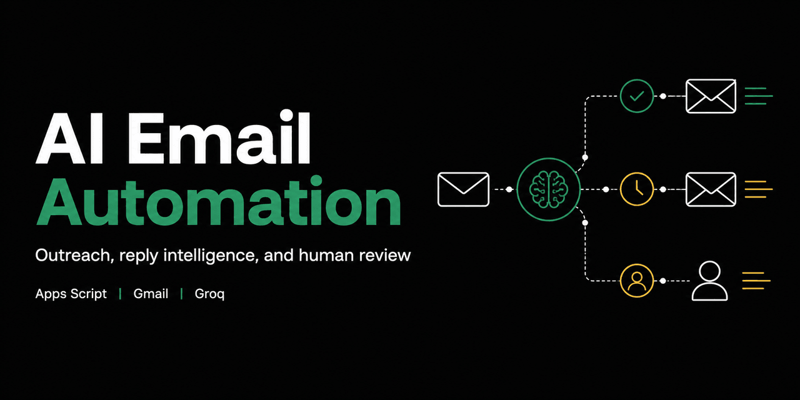

# AI Email Automation

A Google Sheets and Apps Script workflow for preparing outreach, triaging Gmail replies, approving drafts, and scheduling follow-up reviews. Initial outreach and priority reviews use approval. Eligible non-keyword replies can be sent automatically from a private workbook.

1. Follow the [deployment guide](DEPLOYMENT_GUIDE.md) to install the workbook and bind Apps Script.
2. Open **AI Email System → Review queue** and choose **Use my account as reviewer** from the mailbox account that owns the workbook.
3. In **Settings**, control ready lead intake, follow-up scheduling, AI drafting, and reviewer-approved sending. Sending starts paused.
4. Enter product information in **KnowledgeBase**. Add words or phrases under **Review Keywords**. Matching replies go directly to priority review. WhatsApp and Telegram can each send one short alert when configured.
5. Optional AI drafts use the provider, model, and key entered in **Review queue → AI settings**. Supported providers include Groq, OpenAI, Gemini, Claude, and OpenRouter.

Existing leads without a verified initial Gmail message ID require manual reconciliation. Use synthetic data and a dedicated inbox for rollout tests.

[Workflow](DEPENDENCY_DIAGRAM.md) · [Security](SECURITY.md) · [Contributing](CONTRIBUTING.md)

No open-source license is declared. Confirm distribution rights before incorporating this project into another product.
